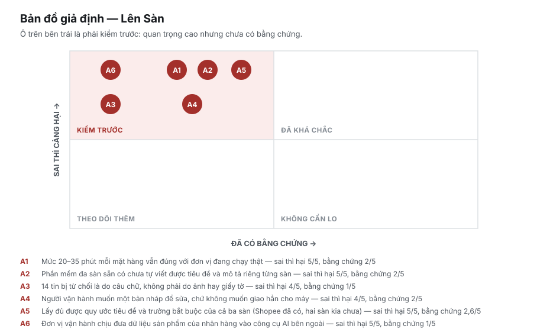
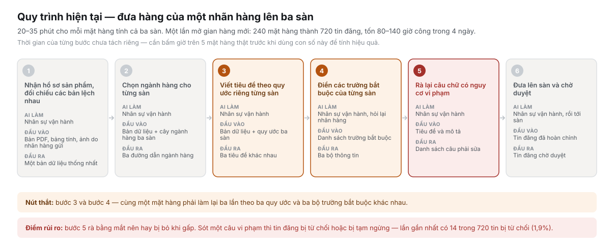
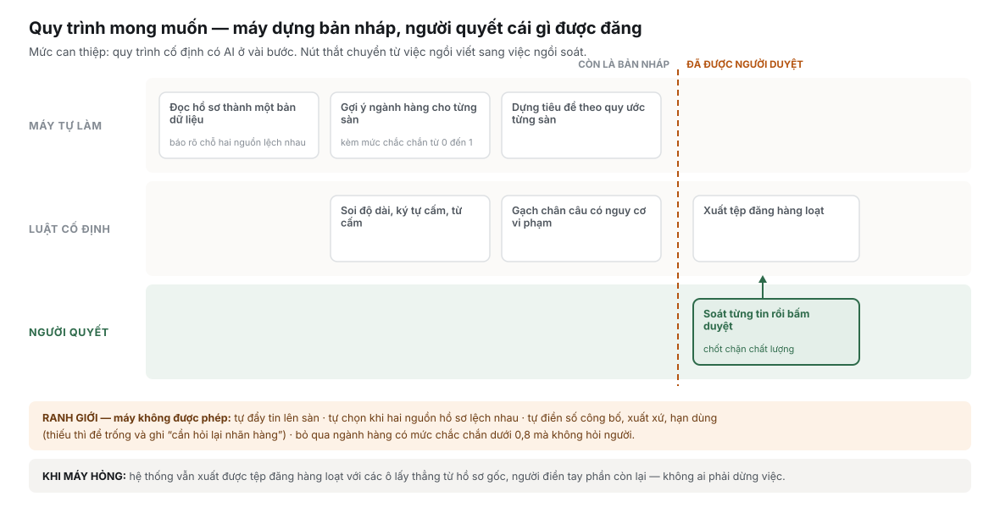
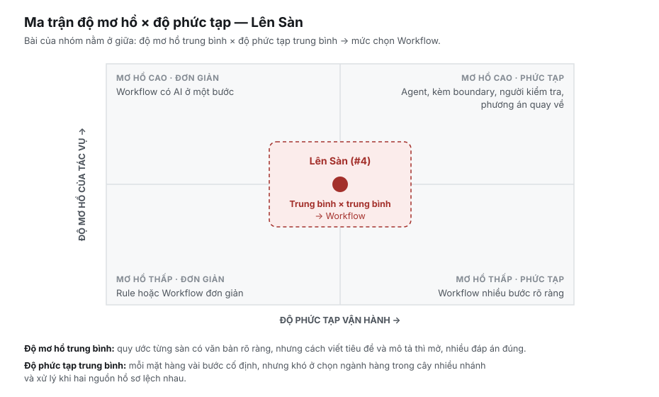

# Báo cáo nhóm — Day 02 Discovery & Problem Framing

> Bản chung của nhóm, viết trên repo do nhóm trưởng fork. Không copy file này sang repo cá nhân.
> Template chi tiết và prompt mẫu: [docs/01-worksheet.md](../../docs/01-worksheet.md). Bài mẫu: [docs/02-deliverable-example.md](../../docs/02-deliverable-example.md).

## 1. Thông tin nhóm

- Tên nhóm: Nhom1
- Thành viên: xem `TEAM.md`
- Candidate problem được chọn (1 câu): Nhân sự vận hành của đơn vị vận hành gian hàng thuê phải viết lại tiêu đề và mô tả cho cùng một mặt hàng ba lần theo quy ước của Shopee, TikTok Shop và Lazada.
- Quyết định cuối: Not Yet

---

## 2. Hội tụ nhóm (CP3)

### 2.1. Pitch

| # | Người đưa ra | Candidate (Job Story ngắn) | Actor | Bottleneck | Câu hỏi phản biện nhận được (ai hỏi) |
|---:|---|---|---|---|---|
| 1 | Cao Duy Minh | Khi phụ huynh nhắn Zalo hỏi lịch học hay xin cho con nghỉ (kể cả tối muộn, cuối tuần), tôi muốn trả lời đúng và ngay, để phụ huynh không phải nhắn lại | Quản lý trung tâm trực Zalo của trung tâm Anh ngữ | Chờ người trực đọc tin: trả lời tay trung vị 0,1–0,7 phút nhưng 10% chậm nhất chờ 80,6 phút (lịch) và 374 phút (xin nghỉ); log Zalo 23/10–9/11/2026 | Trong 10% tin chờ lâu nhất, bao nhiêu tin đến ngoài giờ trực (21h–7h, cuối tuần)? Nếu phần lớn là ngoài giờ thì phân ca đã đủ? (Phúc)<br>Lần gần nhất xử lý tin xin nghỉ ngoài giờ là khi nào, mất bao lâu? Auto-reply Zalo hoặc Google Form báo nghỉ đã đủ chưa? (Bào)<br>Đây là vấn đề phổ biến hay chỉ xảy ra ở một số phụ huynh? (Hải Quân) |
| 2 | Cao Duy Minh | Khi phụ huynh mới hỏi đăng ký, học thử hay kiểm tra đầu vào, tôi muốn trả lời đủ thông tin ngay lần đầu, để họ không chờ rồi tìm trung tâm khác | Quản lý trung tâm phụ trách tuyển sinh qua Zalo | Chờ người trực đọc tin: 10% chậm nhất chờ 783,9 phút (≈13 giờ); 8 cuộc hỏi, trung vị 104 tin mỗi cuộc | Phụ huynh bỏ đi vì chờ trả lời hay vì bị hỏi lại quá nhiều? Trong 8 cuộc tuyển sinh, bao nhiêu cuộc chốt học thử? (Phúc)<br>Khách rời đi vì trả lời chậm hay vì kịch bản tư vấn chưa đủ thuyết phục? Trung tâm khác có xác nhận đây là nỗi đau lớn nhất không? (Bào)<br>Tại sao phụ huynh không đăng ký trực tiếp qua website hoặc hotline hiện tại? (Hải Quân) |
| 3 | Cao Duy Minh | Khi giáo viên dạy xong một buổi và phụ huynh muốn biết bài tập, nhận xét của con, tôi muốn thông tin tới đúng phụ huynh trong ngày, để họ không phải nhắn hỏi lại | Giáo viên đứng lớp + quản lý trung tâm | Chờ người trực đọc và hỏi giáo viên: 10% chậm nhất chờ 80,6 phút; phụ huynh nhắn lại 12 lần trong 16,9 ngày | Bước 3 (hỏi giáo viên) ghi "chưa đo", vậy sao biết nghẽn ở bước 2 chứ không phải bước 3? (Phúc)<br>Tổng hợp nhận xét cho một lớp 20 học sinh mất bao lâu? Template Google Sheets có checklist cho giáo viên tick có giảm được 80% thời gian không? (Bào)<br>Phụ huynh có thực sự đọc và phản hồi những nhận xét này không? (Hải Quân) |
| 4 | Nguyễn Văn Hải Quân | Khi nhận catalog của một brand mới, tôi muốn có listing đúng quy ước của từng sàn Shopee, TikTok Shop, Lazada cho mọi SKU, để mở bán đúng hẹn mà không bị sàn từ chối | Nhân sự vận hành tại enabler (vận hành gian hàng thay brand) | Bước 3–4: viết lại tiêu đề và điền thuộc tính 3 lần cho 3 sàn; ước tính 10–20 phút/SKU/sàn (nguồn ngoài, chưa bấm giờ); lần onboard gần nhất 240 SKU × 3 sàn = 720 listing trong 4 ngày, 14 listing bị từ chối | Lần onboard 240 SKU thực tế mấy người làm, tổng bao nhiêu giờ? 14 listing bị từ chối do lỗi gì? (Phúc)<br>Nút thắt là format text cho từng sàn hay chỉnh ảnh/video đúng chuẩn? Lần gần nhất listing 100 sản phẩm lên 3 sàn mất bao nhiêu giờ? (Bào) |
| 5 | Nguyễn Văn Hải Quân | Khi vừa học xong một buổi ở lớp AI Thực Chiến 20K, tôi muốn ghi chú của buổi đó được sắp xếp gọn vào đúng chỗ, để tuần sau tra lại được mà không phải xem lại cả buổi | Học viên lớp 20K | Bước 3, viết lại ghi chú có cấu trúc, trong tổng 45 phút/buổi (chưa tách phút của bước); hơn 10 lần/tuần phải mở lại slide/recording | Trong 45 phút, bao nhiêu phút gom slide, bao nhiêu phút viết lại? Template Notion cố định đã thử chưa? (Phúc)<br>Ghi chú phục vụ mục đích cuối cùng gì? Có bằng chứng học viên thật sự đọc lại, hay bottleneck là thiếu động lực học? (Bào) |
| 6 | Nguyễn Văn Hải Quân | Khi viết phần tài liệu liên quan cho bài CAR, tôi muốn nắm nhanh phương pháp, dữ liệu và hạn chế của từng bài báo, để so sánh được với hướng của mình | Sinh viên làm nghiên cứu và thầy hướng dẫn | Bước 3–4, đọc sâu phương pháp và thực nghiệm, trong tổng 30 phút/bài (chưa tách phút của bước); 7–10 bài; 2–3 lần mở lại bài đã đọc | Còn bao nhiêu bài phải đọc nữa? 30 phút/bài là bấm giờ hay ước chừng? (Phúc)<br>Lần gần nhất làm bảng so sánh là khi nào? Nút thắt là lập bảng hay đọc hiểu sâu từng paper? (Bào) |
| 7 | Bùi Phan Thanh Phúc | Khi cần mua một món trên Shopee có nhiều shop cùng bán, tôi muốn biết shop nào đáng mua nhất, để không mua nhầm hàng kém hoặc giá cao | Người mua cá nhân | Bước 3, đọc đánh giá từng shop: 20–50 phút trong tổng 30–60 phút/lần; 2–3 lần/tháng | Lọc đánh giá 1–2 sao và đánh giá có ảnh/video đã đủ để quyết định chưa? Bottleneck là đọc quá nhiều hay review seeding/giả? (Bào)<br>Giải pháp có xử lý được tình trạng đánh giá ảo hoặc đánh giá seeding không? (Hải Quân) |
| 8 | Bùi Phan Thanh Phúc | Khi vừa họp nhóm xong, tôi muốn có danh sách việc, người phụ trách và hạn, để không ai bỏ sót | Thành viên nhóm ghi chú sau họp | Bước 2, tách việc cụ thể từ ghi chú lộn xộn: 10 phút trong tổng 30 phút/buổi; 1 buổi/tuần | Ai ngoài bạn gặp vấn đề này? Cử thư ký gõ ngay vào template "Task – Assignee – Deadline" trong lúc họp có nhanh hơn không? (Bào)<br>Tại sao không dùng các công cụ như Notion, Trello hoặc Google Docs? (Hải Quân) |
| 9 | Bùi Phan Thanh Phúc | Khi phải đọc tài liệu dài của khóa, tôi muốn tìm nhanh phần liên quan tới lab, để không phải lục lại từng phần | Học viên làm lab | Bước 3, tìm phần liên quan tới lab: 20 phút trong tổng 45 phút/lần; 2 lần/tuần ≈ 90 phút/tuần | Lần gần nhất tìm không thấy thông tin lab mất bao lâu? Ctrl+F với từ khoá "lab" đã giải quyết được chưa? (Bào)<br>Tại sao không dùng Ctrl + F hoặc tìm kiếm có sẵn trong PDF? (Hải Quân) |
| 10 | Nguyễn Khắc Bào | Khi nhận bản vẽ/đặc tả nội thất (PDF scan, Excel tự do) từ khách hoặc KTS, tôi muốn trích đúng danh mục vật tư và định mức, để lập bảng dự toán BOM báo giá không sót linh kiện hay lỗ chi phí | Chủ xưởng nội thất / kỹ sư dự toán báo giá | Bước 3, nhập tay định mức BOM: 50 phút, và bước 5, rà soát chéo: 25 phút, trong tổng 120 phút/hồ sơ; 3–4 hồ sơ/tuần; lệch giá vốn ~190k–400k/md khi sai | 120 phút/hồ sơ và ~8% dòng sai lấy từ hồ sơ nào, bấm giờ hay ước? Nếu khách điền template Excel chuẩn thì Rule đã đủ chưa? (Phúc)<br>Nếu bản vẽ thiếu thông tin hoặc sai lệch, BOM tạo ra có đáng tin cậy không? (Hải Quân) |
| 11 | Nguyễn Khắc Bào | Khi khách chuyển khoản cọc (40%) hoặc nghiệm thu (60%) qua VietQR của xưởng, tôi muốn đối chiếu nhanh giao dịch với đúng mã đơn và đợt trả, để gạch nợ chính xác | Chủ xưởng nội thất / thu ngân xưởng | Bước 2–3, dò tay mã đơn và hỏi lại ca thiếu mã: 22 phút trong tổng 30 phút/ngày; 15–25 giao dịch/tuần; ~25% giao dịch phải hỏi lại | 30 phút/ngày là bấm giờ ngày nào? QR đã có sẵn mã đơn thì khách sai mã khi nào, chiếm bao nhiêu trong ~25%? (Phúc)<br>Nếu nội dung chuyển khoản sai hoặc thiếu mã đơn, hệ thống xử lý thế nào? (Hải Quân) |
| 12 | Nguyễn Khắc Bào | Khi người dùng xưởng hoặc tester báo lỗi mơ hồ, tôi muốn gom đủ ngữ cảnh và đối chiếu đúng FR trong spec ngay lần đầu, để khoanh vùng lỗi mà không hỏi lại nhiều vòng | Lập trình viên bảo trì app FurniCore (cùng chủ xưởng, tester báo lỗi) | Bước 2, hỏi lại bối cảnh và xin log: 20 phút + chờ 2–4 giờ, và bước 4, đối chiếu spec: 15 phút, trong tổng 55 phút/ca; ~60% ca phải hỏi vòng 2 | "Chờ 2–4 giờ hỏi lại" là hỏi ai? Có nút "Xuất gói chẩn đoán" rồi thì bước nào còn cần AI? (Phúc)<br>Tại sao tester không sử dụng Jira hoặc các công cụ quản lý bug hiện có? (Hải Quân) |

### 2.2. Cluster

Nhóm 4 người, 12 candidate.

| Cluster | Các candidate | Pattern chung |
|---|---|---|
| A — Trả lời câu hỏi lặp lại | Phụ huynh hỏi lịch / xin nghỉ (#1), phụ huynh mới hỏi đăng ký (#2) | Câu trả lời đã có sẵn nhưng phải chờ người trực mới gửi được |
| B — Hỏi lại vì thiếu thông tin | Nhận xét giáo viên → phụ huynh (#3), báo lỗi mơ hồ → dev (#12) | Một bên có ngữ cảnh, bên kia phải hỏi lại và chờ |
| C — Chuyển nguồn thô sang khuôn chuẩn | Listing 3 sàn (#4), ghi chú buổi học (#5), việc sau họp (#8), bảng BOM báo giá (#10) | Đọc nguồn lộn xộn rồi nhập lại bằng tay theo một khuôn |
| D — Đọc nhiều để tìm, so sánh | So sánh paper (#6), so sánh shop Shopee (#7), tìm phần cần cho lab (#9) | Thông tin nằm rải trong nhiều nguồn hoặc một tài liệu dài |
| E — Đối soát chuyển khoản | Khớp chuyển khoản VietQR với mã đơn (#11) | Nội dung chuyển khoản thiếu hoặc sai mã nên phải dò tay |

### 2.3. Opportunity Solution Tree rút gọn

Dựng theo candidate đang dẫn đầu (#4 Listing 3 sàn, 3/3 phiếu); sẽ cập nhật nếu nhóm chốt candidate khác.

```text
OUTCOME: Giảm thời gian từ lúc nhận catalog brand tới lúc mở bán đủ SKU trên 3 sàn, mà tỷ lệ listing bị sàn từ chối không tăng
├── Opportunity: Catalog brand lộn xộn và lệch nhau giữa các file (PDF, Excel, ảnh), phải đối chiếu tay
├── Opportunity: Cùng một SKU phải viết lại tiêu đề và thuộc tính 3 lần theo 3 quy ước sàn khác nhau
├── Opportunity: Câu quảng cáo vi phạm bị bỏ sót, listing bị từ chối hoặc đình chỉ (14/720 listing ở lần onboard gần nhất)
└── Opportunity: Ảnh, video phải chỉnh lại cho đúng chuẩn từng sàn (câu hỏi của Bào, chưa có số liệu)
```

Những ý đã gạch bỏ vì là solution đội lốt opportunity:

- "Tool tạo listing đa sàn bằng AI"
- "Phần mềm quản lý đa kênh"
- "File đăng hàng loạt của sàn"

### 2.4. Chấm điểm shortlist (1–5)

4/4 người chấm qua form (Minh, Phúc, Bào, Hải Quân). Điểm là trung bình 4 người. Chỉ ghi các candidate có ít nhất 1 phiếu vào shortlist.

| Candidate | Actor rõ | Quy trình rõ | Pain có bằng chứng | Impact đo được | Vừa sức lab | So sánh được No AI/Rule/Workflow/Agent | Nhóm hiểu domain | Tổng |
|---|---:|---:|---:|---:|---:|---:|---:|---:|
| #4 Listing 3 sàn (4 phiếu) | 5 | 5 | 5 | 5 | 5 | 5 | 5 | 35 |
| #10 Bảng BOM báo giá (2 phiếu) | 4,5 | 4 | 4,5 | 3,5 | 3,5 | 4,2 | 3,8 | 28 |
| #7 So sánh shop Shopee (1 phiếu) | 4 | 3,8 | 4 | 4 | 3,8 | 4 | 4 | 27,5 |
| #8 Việc sau họp (1 phiếu) | 4,2 | 4 | 4 | 3,5 | 4 | 3,5 | 4 | 27,2 |
| #3 Nhận xét giáo viên → phụ huynh (2 phiếu) | 3,8 | 3,8 | 4 | 3,8 | 4 | 3,8 | 3,8 | 26,8 |
| #5 Ghi chú buổi học (1 phiếu) | 4 | 4 | 4 | 3,8 | 3,5 | 3,8 | 3,8 | 26,8 |
| #12 Báo lỗi mơ hồ (1 phiếu) | 3,8 | 4 | 4 | 3,2 | 3,8 | 4 | 3,8 | 26,5 |

**Candidate được chọn:** #4 — Dựng listing đa sàn (Shopee, TikTok Shop, Lazada) từ catalog của nhãn hàng (Hải Quân).

**Vì sao chọn:** Cả 4 người chấm đều đưa #4 vào shortlist và cho điểm cao nhất (35/35, hơn candidate đứng thứ hai 7 điểm). Việc lặp theo từng mặt hàng × sàn nên quy trình vẽ được và đo được (240 mặt hàng → 720 tin, 14 tin bị từ chối). Nhóm có thành viên làm đúng nghề này nên tìm được người thật để kiểm chứng ở CP4.

**Vì sao loại các candidate còn lại:**
- #1 Phụ huynh hỏi lịch / xin nghỉ: bottleneck là không có người đọc tin (khi có người trực, trả lời trung vị 0,1 phút), nên phân ca trực + ghim lịch lớp giải được mà không cần AI (Phúc).
- #9 Tìm phần cần cho lab trong tài liệu dài: giải được bằng tìm kiếm văn bản (Ctrl+F, regex), khó chứng minh impact vượt trội (Bào).
- #8 Việc sau họp: chỉ 1 buổi/tuần, 30 phút/buổi; một mẫu biên bản có cột Việc / Người / Hạn điền ngay trong họp có thể đủ (câu hỏi của Bào).
- #11 Đối chiếu chuyển khoản VietQR: các giao dịch đều đã có mã để đối soát (Hải Quân).
- #3 Nhận xét giáo viên → phụ huynh: bước hỏi giáo viên chưa đo nên chưa chứng minh được nghẽn ở đâu (Phúc); template checklist cho giáo viên có thể đã giảm phần lớn thời gian (Bào).

**Xử lý bất đồng (nếu có):** Không có bất đồng về lựa chọn cuối: cả 4 người đều chọn #4.

---

## 3. Kiểm chứng + research giải pháp đã có (CP4)

### 3.1. Assumption Map



| # | Giả định | Loại (Value / Usability / Feasibility / Viability) | Quan trọng (1–5) | Đã có bằng chứng (1–5) | Kiểm chứng trước? |
|---:|---|---|---:|---:|---|
| 1 | Mức 20–35 phút mỗi mặt hàng (cả ba sàn) vẫn đúng với đơn vị vận hành đang chạy thật | Value | 5 | 2 | **Có** |
| 2 | Phần mềm đa sàn sẵn có chưa tự viết được tiêu đề và mô tả riêng cho từng sàn | Viability | 5 | 2 | **Có** |
| 3 | 14 tin bị từ chối là do câu chữ, không phải do ảnh hay giấy tờ | Value | 4 | 1 | **Có** |
| 4 | Người vận hành muốn một bản nháp để sửa, không muốn giao hẳn cho máy | Usability | 4 | 2 | **Có** |
| 5 | Lấy đủ được quy ước tiêu đề và trường bắt buộc của cả ba sàn (Shopee đã có, hai sàn kia chưa) | Feasibility | 5 | 2,6 | Có (phần TikTok Shop, Lazada) |
| 6 | Đơn vị vận hành chịu đưa dữ liệu sản phẩm của nhãn hàng vào công cụ AI bên ngoài | Viability | 5 | 1 | **Có** |

**Giả định nhóm kiểm chứng trong buổi này:** số 1 (hỏi lại người từng làm, cần bấm giờ lại với người đang làm), số 2 (đọc tài liệu của Sapo và BigSeller), số 5 (tìm quy ước của ba sàn). Số 3, 4, 6 cần người của đơn vị vận hành đang hoạt động nên để cho vòng sau.

### 3.2. Kiểm chứng

**Cách đã dùng:** Phỏng vấn (1 người) + đọc tài liệu công khai của sàn và của các phần mềm đa sàn. Chưa dùng survey hay log/ticket/review.

**Interview snapshot (buổi 1)**

| Trường | Nội dung |
|---|---|
| Người được hỏi (vai trò, không ghi tên thật) | Người từng làm vận hành gian hàng thuê (đơn vị vận hành gian hàng cho nhãn hàng), đã rời ngành một thời gian. Không phải thành viên nhóm. Hỏi 2 lần (lần 2 để hỏi lại thời gian mỗi mặt hàng); hình thức hỏi: Nhắn tin|
| Câu nói đáng nhớ nhất | Làm sao để cạnh tranh được với những nền tảng đã tồn tại trong thời gian dài rồi? |
| Lần gần nhất gặp vấn đề này: chuyện gì đã xảy ra? | Mở gian hàng mới cho một nhãn hàng có 240 mặt hàng, phải đưa lên cả ba sàn. Cùng một mặt hàng phải viết lại ba lần theo ba bộ quy ước khác nhau. Có 14 trong 720 tin bị sàn từ chối |
| Hiện đang xử lý bằng cách nào (workaround)? | Làm tay: đối chiếu hồ sơ, chọn ngành hàng, viết tiêu đề, điền trường, rồi rà câu chữ bằng mắt trước khi đăng |
| Mất bao lâu, bao lần? | 4 ngày, 80–140 giờ công cho một lần mở gian hàng mới (240 mặt hàng → 720 tin), tức 20–35 phút mỗi mặt hàng cho cả ba sàn. Tần suất: mỗi lần có nhãn hàng mới ký hợp đồng |
| Insight / opportunity rút ra | Thời gian đi vào việc lặp lại ba lần; việc rà câu chữ dễ bị bỏ khi gấp và là chỗ sinh ra tin bị từ chối. Cơ hội: dựng sẵn bản nháp theo quy ước từng sàn để người chỉ còn soát |

**Tổng hợp:**

| Nguồn | Số người / số mẫu | Tín hiệu xác nhận | Tín hiệu phản bác |
|---|---:|---|---|
| Phỏng vấn người từng làm vận hành | 1 người | 240 mặt hàng → 720 tin, 80–140 giờ công, 14/720 bị từ chối | Chưa có trực tiếp. **Đây là trí nhớ về một lần đã qua, không phải số đo hiện tại, và chỉ có một người** |
| Trang hướng dẫn người bán của Shopee | 2 bài | Quy ước có nhiều ràng buộc: tối đa 120 ký tự, cấm viết hoa toàn bộ, cấm một loạt cụm quảng cáo, mỗi ngành hàng có cấu trúc đặt tên riêng | Không |
| Bài của BigSeller | 1 bài | Bài không nhắc việc viết tiêu đề hay mô tả riêng cho từng sàn | **Đã tự điền danh mục, giá, tồn kho và phân loại theo quy tắc rồi đăng hàng loạt lên nhiều sàn: phủ bước 2, một phần bước 4 và bước 6** |
| Bài của Sapo | 1 bài | — | **Sapo nói có "đăng bán đa sàn từ một hệ thống quản lý tập trung, đồng thời gợi ý mô tả sản phẩm phù hợp với yêu cầu riêng của Shopee, Lazada hay TikTok Shop" — đúng phần nhóm định làm.** Chưa dùng thử để biết thực tế đến đâu |
| Tài liệu TikTok Shop, Lazada | 0 | — | Chưa kiểm được. Giới hạn ký tự và quy tắc "bắt đầu bằng thương hiệu" trong Problem Card lấy từ dữ liệu giả lập của bản chạy thử, không phải tài liệu sàn |

**Nhóm đã sửa problem thế nào sau kiểm chứng:**

1. Thu hẹp bottleneck từ "bước 3 và 4" xuống chủ yếu **bước 3 (viết tiêu đề và mô tả theo từng sàn)**, vì BigSeller đã tự điền danh mục, giá, phân loại theo quy tắc.
2. Thêm chi tiết: quy ước khác nhau **theo từng ngành hàng**, không chỉ theo từng sàn. Điều này chỉ lộ ra khi đọc trang hướng dẫn của Shopee.
3. Bỏ các con số quy ước của TikTok Shop và Lazada khỏi phần lập luận cho tới khi kiểm được từ tài liệu sàn.
4. Đưa giả định số 2 lên ưu tiên cao nhất: nếu tính năng gợi ý mô tả của Sapo đã làm tốt bước 3, bài toán của nhóm chỉ còn bước rà câu chữ vi phạm.

### 3.3. Research giải pháp đã có

| Công cụ / case / pattern | Link | Giải bước nào trong quy trình? | Điểm mạnh | Khoảng trống / rủi ro | Bài học cho nhóm |
|---|---|---|---|---|---|
| BigSeller | [Phần mềm quản lý bán hàng đa kênh Shopee, Lazada, TikTok Shop](https://www.bigseller.com/blog/articleDetails/phan-mem-quan-ly-ban-hang-da-kenh-da-shop.4972.htm) | Bước 2 (ngành hàng), một phần bước 4 (phân loại), bước 6 (đăng) | Thiết lập quy tắc để tự điền danh mục, giá, tồn kho, phân loại rồi đăng hàng loạt lên nhiều gian hàng; đã có người dùng | Bài không nhắc việc viết tiêu đề, mô tả riêng từng sàn hay rà câu chữ vi phạm → bước 1, 3, 5 còn trống. Đây là bài tự giới thiệu, chưa dùng thử | Không cạnh tranh ở bước 2, 4, 6. Tập trung vào bước 3 và bước rà câu chữ |
| Sapo | [Vận hành sàn thương mại điện tử đa kênh](https://www.sapo.vn/blog/van-hanh-san-thuong-mai-dien-tu) | Bước 6, có thể cả bước 3 | Đăng bán đa sàn từ một hệ thống; nói có gợi ý mô tả sản phẩm khớp yêu cầu riêng từng sàn | **Nếu đúng như bài viết thì trùng thẳng với ý tưởng của nhóm.** Chưa rõ gợi ý đến mức nào | Việc đầu tiên phải làm: dùng thử, chạy 5 mặt hàng thật, ghi lại nó viết ra gì |
| Trang hướng dẫn người bán của Shopee | [Shopee Seller Education Hub, bài 13322](https://banhang.shopee.vn/edu/article/13322) | Bước 3, 5 (là nguồn quy ước, không phải công cụ) | Tài liệu gốc, rõ ràng, có công thức đặt tên sản phẩm | Chỉ là quy ước, không tự kiểm. Mỗi ngành hàng còn một cấu trúc riêng | Có thể mã hóa thành luật cố định để soi tự động, không cần AI cho phần này |
| Bài Shopee về tên sản phẩm của gian hàng chính hãng | [Shopee Seller Education Hub, bài 3531](https://banhang.shopee.vn/edu/article/3531) | Bước 3 | Nêu độ dài tối thiểu của tên theo loại gian hàng (20 ký tự với gian hàng chính hãng, 10 ký tự với gian hàng thường) | Cùng hạn chế như trên | Luật độ dài khác nhau theo loại gian hàng, cần đưa vào bộ soi |

---

## 4. Quy trình trước/sau (CP5)

### 4.1. Quy trình hiện tại



| Bước | Actor | Input | Output | Thời gian / tần suất | Ghi chú |
|---:|---|---|---|---|---|
| 1 | Nhân sự vận hành | Hồ sơ sản phẩm (PDF, bảng tính, ảnh) từ nhãn hàng | Một bản dữ liệu thống nhất | Chưa đo riêng | Các nguồn hay lệch nhau |
| 2 | Nhân sự vận hành | Bản dữ liệu + cây ngành hàng ba sàn | Ba đường dẫn ngành hàng | Chưa đo riêng | |
| 3 | Nhân sự vận hành | Bản dữ liệu + quy ước ba sàn | Ba tiêu đề khác nhau | Chưa đo riêng | **Nút thắt**: viết lại ba lần |
| 4 | Nhân sự vận hành, hỏi lại nhãn hàng | Danh sách trường bắt buộc | Ba bộ thông tin | Chưa đo riêng | Thiếu thông tin thì phải chờ nhãn hàng |
| 5 | Nhân sự vận hành | Tiêu đề và mô tả | Danh sách câu phải sửa | Chưa đo riêng | Rà bằng mắt, hay bị bỏ khi gấp |
| 6 | Nhân sự vận hành → sàn | Tin đăng hoàn chỉnh | Tin đăng chờ duyệt | Chưa đo riêng | 14/720 tin bị từ chối |

*Tổng:* 20–35 phút mỗi mặt hàng cho cả ba sàn; 240 mặt hàng ≈ 80–140 giờ công trong 4 ngày. Chưa tách thời gian theo bước.

**Bottleneck chính:** Bước 3 — cùng một mặt hàng phải viết lại ba lần theo ba quy ước (và quy ước còn khác theo ngành hàng). Đây là suy đoán của nhóm, chưa chứng minh vì chưa bấm giờ từng bước.

### 4.2. Quy trình tương lai



- **Bước do AI làm (dựng nháp):** đọc hồ sơ thành bản dữ liệu và báo chỗ lệch; gợi ý ngành hàng kèm mức chắc chắn 0–1; dựng tiêu đề và mô tả theo quy ước từng sàn.
- **Bước do Rule làm:** soi độ dài, ký tự cấm, từ cấm; gạch chân câu có nguy cơ vi phạm; xuất tệp đăng hàng loạt.
- **Bước do con người làm:** soát từng tin rồi bấm duyệt; chọn bên nào khi hai nguồn hồ sơ lệch nhau; điền các trường mà hồ sơ thiếu.
- **Boundary:** máy không được tự đăng lên sàn; không tự chọn khi hai nguồn lệch nhau; không tự điền số công bố, xuất xứ, hạn dùng (thiếu thì để trống và ghi "cần hỏi lại nhãn hàng"); ngành hàng có mức chắc chắn dưới 0,8 bắt buộc hỏi người.
- **Phương án quay về khi AI sai:** nếu model lỗi hoặc bản nháp quá kém, hệ thống vẫn xuất được tệp đăng hàng loạt với các ô lấy thẳng từ hồ sơ gốc; người điền tay phần còn lại. Không ai phải dừng việc.

### 4.3. Before / after

| Chỉ số | Trước | Sau (kỳ vọng) | Ghi chú |
|---|---|---|---|
| Số bước | 6 | 7 (thêm bước duyệt) | Phần lớn các bước thành tự động |
| Tổng thời gian | 20–35 phút / mặt hàng (cả 3 sàn) | **〔đề xuất〕** giảm ít nhất 40% | Chưa có số "sau" vì chưa chạy thử với người thật; phải bấm giờ 20 mặt hàng trước và sau |
| Số bước thủ công | 6 | 1–2 (duyệt, và điền phần hồ sơ thiếu) | Việc duyệt vẫn là thủ công có chủ đích |
| Bottleneck chính | Viết tiêu đề lặp ba lần | Soát bản nháp | Nút thắt chuyển từ "viết" sang "soát" |
| Rủi ro mới phát sinh | — | Người duyệt tin tưởng quá mức và bấm duyệt không đọc; máy bỏ sót câu vi phạm; dữ liệu nhãn hàng đi ra công cụ AI bên ngoài | Giải quyết bằng ngưỡng nghiêng về báo thừa, và hỏi trước về điều khoản bảo mật |

---

## 5. Problem Statement v0 (CP5)

| Trường | Nội dung |
|---|---|
| **Actor** | Nhân sự vận hành của đơn vị vận hành gian hàng thuê (làm cho nhãn hàng trên Shopee, TikTok Shop, Lazada) |
| **Quy trình** | Đưa hàng của một nhãn hàng lên cả ba sàn, từ nhận hồ sơ đến lúc tin chờ duyệt |
| **Bottleneck** | Bước 3 và 4: cùng một mặt hàng phải viết lại ba lần theo ba quy ước và ba bộ trường bắt buộc khác nhau |
| **Impact** | 240 mặt hàng → 720 tin đăng, tốn 80–140 giờ công trong 4 ngày; 14/720 tin (1,9%) bị từ chối. *(Nguồn: một người đã rời ngành, chưa đo lại)* |
| **Success Metric** (baseline → target, cách đo) | Giờ công cho mỗi 100 mặt hàng: baseline **〔phải bấm giờ lại〕** → giảm ít nhất 40% 〔đề xuất〕, đo bằng bấm giờ 20 mặt hàng trước/sau. Tỷ lệ tin bị từ chối lần đầu: 1,9% → không tăng, đo bằng đếm thông báo từ chối trên 100 tin đầu |
| **Boundary** (AI không được làm gì; khi nào cần con người kiểm tra — HITL) | AI không tự đăng, không tự điền số công bố/xuất xứ/hạn dùng, không tự chọn khi hai nguồn lệch. Con người duyệt từng tin trước khi đăng; hỏi lại nhãn hàng khi hồ sơ thiếu |

**Phản biện nhận được (từ AI hoặc nhóm khác) và nhóm có đồng ý không:**

| Phản biện | Từ ai | Nhóm có đồng ý? |
|---|---|---|
| "BigSeller và Sapo đã đăng đa sàn rồi, sao nhóm cần làm?" | Tự rà khi nghiên cứu đối thủ | Đồng ý một phần: BigSeller phủ bước 2/4/6 nhưng để người tự viết tiêu đề và mô tả. Sapo thì **chưa kiểm được**. Đã thu hẹp bài toán vào bước 3 |
| "Các con số 240 / 80–140 giờ chỉ từ một người đã rời ngành" | Tự rà | Đồng ý hoàn toàn. Đã ghi vào mục Hạn chế và đưa thành giả định số 1 cần kiểm trước |
| "Giới hạn ký tự TikTok Shop và Lazada lấy từ đâu?" | Tự rà | Đồng ý: lấy từ tệp giả lập của bản chạy thử. Đã bỏ khỏi phần lập luận |
| Khi pitching, các nhóm khác và giảng viên chủ yếu đặt câu hỏi để hiểu rõ ý tưởng/sản phẩm, chưa phản biện trực diện | Nhóm khác / giảng viên | Ghi nhận |

---

## 6. Mức can thiệp AI (CP6)

### 6.1. Ma trận độ mơ hồ × độ phức tạp



**Bài của nhóm nằm ở ô:** độ mơ hồ **trung bình** × độ phức tạp **trung bình**.

**Vì sao:** quy ước của từng sàn có văn bản rõ ràng (ít mơ hồ ở phần luật), nhưng cách diễn đạt tiêu đề và mô tả thì mở, có nhiều đáp án đúng. Về độ phức tạp, mỗi mặt hàng chỉ cần vài bước cố định, không phải một chuỗi quyết định dài; nhưng có chỗ khó thật là chọn ngành hàng trong cây rất nhiều nhánh, và xử lý khi hai nguồn hồ sơ lệch nhau.

### 6.2. So sánh 4 mức

| Mức | Phương án cho bài của nhóm | Đủ khi nào | Rủi ro | Chọn? |
|---|---|---|---|---|
| No AI (sửa quy trình) | Lập bảng quy ước ba sàn theo ngành hàng và mẫu tiêu đề điền sẵn; người vẫn tự viết | Khi khối lượng nhỏ hoặc quy ước ít đổi | Giữ nguyên nút thắt viết lại ba lần; không đo được cải thiện lớn | Không |
| Rule | Ghép trường, soi độ dài / ký tự cấm / từ cấm, xuất tệp đăng hàng loạt | Khi tiêu đề có thể lắp từ các trường có sẵn theo công thức | Không viết được câu tự nhiên; chính là phần BigSeller đã làm | Không đủ, nhưng **dùng làm một phần** |
| Workflow | Chuỗi bước cố định, AI chỉ làm bước ngôn ngữ (đọc hồ sơ, gợi ý ngành hàng, dựng tiêu đề), Rule soi lại, người duyệt | Khi các bước biết trước và AI cần giúp ở vài điểm | AI viết sai giọng hoặc bỏ sót câu vi phạm; xử lý bằng ngưỡng và người duyệt | **Chọn** |
| Agent | AI tự đọc, tự chọn, tự đăng, tự xử lý khi bị từ chối | Khi bước đi thay đổi theo từng trường hợp và sai không đắt | Sai thì tin bị từ chối hoặc gian hàng bị phạt; người vận hành cũng chịu trách nhiệm trước nhãn hàng, không giao hẳn quyền đăng | Không |

**Mức chọn:** Workflow.

**Vì sao không chọn mức đơn giản hơn:** Rule đã đủ cho phần soi ký tự và xuất tệp, nhưng nút thắt chính là viết tiêu đề và mô tả theo từng sàn — Rule không viết được câu tự nhiên, và đúng phần đó BigSeller cũng chưa làm. No AI thì giữ nguyên nút thắt. Vậy cần AI cho đúng bước viết, còn lại để Rule và người.

### 6.3. AI Canvas rút gọn

| Thành phần | Nội dung |
|---|---|
| Prediction — AI dự đoán / tạo ra gì? | Cho mỗi mặt hàng và mỗi sàn: tiêu đề, mô tả, ngành hàng gợi ý (kèm mức chắc chắn), các trường điền được |
| Judgment — con người cân nhắc, quyết định gì? | Bản nháp đã đúng hàng chưa, đúng quy ước chưa, có dám đăng không; chọn nguồn nào khi hồ sơ lệch |
| Action — hành động cuối cùng là gì, ai làm? | Nhân sự vận hành bấm duyệt (hoặc sửa rồi duyệt, hoặc trả lại hỏi nhãn hàng), rồi đăng |
| Outcome — đo kết quả bằng gì? | Giờ công cho mỗi 100 mặt hàng; tỷ lệ tin bị từ chối lần đầu |
| Input — AI cần dữ liệu đầu vào gì mỗi lần chạy? Có sẵn không? | Hồ sơ sản phẩm của nhãn hàng (có, nhưng nhiều định dạng và hay lệch); quy ước và cây ngành hàng từng sàn (Shopee có từ tài liệu; TikTok Shop và Lazada **chưa có**); các tin đã đăng thành công (cần xin) |
| Feedback — lấy phản hồi ở đâu để cải thiện? | Mỗi chỗ người sửa tay được ghi lại; mỗi tin bị sàn từ chối ghi kèm lý do. Hai thứ này dùng để sửa lời nhắc và bổ sung luật |

### 6.4. Hai câu hỏi của Google PAIR

**Người dùng muốn được hỗ trợ (augment) hay giao hẳn việc (automate)? Bằng chứng:** Hỗ trợ (augment). Bằng chứng hiện có yếu: chỉ từ ràng buộc nghề (đơn vị vận hành chịu trách nhiệm trước nhãn hàng, nên không thể giao hẳn việc đăng) và từ việc sàn có thể phạt gian hàng. **Chưa có bằng chứng từ người đang làm nghề rằng họ muốn nháp hơn là tự động** — đây là giả định số 4, cần kiểm.

**AI sai kiểu nào tệ hơn, báo nhầm hay bỏ sót? Vì sao, và thiết kế đã xử lý thế nào:**

| Kiểu sai | Chuyện gì xảy ra | Chi phí |
|---|---|---|
| Báo nhầm — gạch chân câu thực ra không vi phạm | Người liếc qua rồi bỏ qua | Thấp: vài giây |
| Bỏ sót — không gạch chân câu thật sự vi phạm | Tin bị từ chối, nặng hơn thì gian hàng bị trừ điểm | Cao: làm lại, mất ngày bán |

**Bỏ sót tệ hơn.** Thiết kế nghiêng về báo nhầm: thà gạch nhầm mười câu hơn sót một câu. Ngành hàng dưới mức chắc chắn 0,8 thì bắt buộc hỏi người, không được tự chọn. Người duyệt luôn là chốt chặn cuối.

---

## 7. Problem Statement v1 + tiêu chí đánh giá (CP6)

| Trường | Nội dung |
|---|---|
| Actor | Nhân sự vận hành của đơn vị vận hành gian hàng thuê |
| Quy trình | Đưa hàng của một nhãn hàng lên cả ba sàn |
| Bottleneck | Bước viết tiêu đề và mô tả: phải viết lại ba lần, quy ước khác nhau theo từng sàn **và theo từng ngành hàng**. Phần mềm đa sàn sẵn có (BigSeller) đã lo bước ghép ngành hàng và điền trường nhưng để người tự viết tiêu đề |
| Impact | 240 mặt hàng → 720 tin, 80–140 giờ công trong 4 ngày; 14/720 tin (1,9%) bị từ chối *(nguồn đã rời ngành, cần đo lại)* |
| Success Metric (baseline → target, cách đo) | Giờ công / 100 mặt hàng: 〔bấm giờ lại〕 → giảm ≥ 40% 〔đề xuất〕, bấm giờ 20 mặt hàng. Tỷ lệ tin bị từ chối lần đầu: 1,9% → không tăng, đếm trên 100 tin. Tỷ lệ bản nháp được duyệt không sửa: → ≥ 50% 〔đề xuất〕. Số câu vi phạm bị sót trên 100 tin: 0, người độc lập đọc lại |
| Boundary | AI không tự đăng; không tự điền số công bố, xuất xứ, hạn dùng; không tự chọn khi hai nguồn lệch; ngành hàng dưới 0,8 phải hỏi người. Người duyệt từng tin trước khi đăng |
| AI intervention point | Ba chỗ: đọc hồ sơ thành bản dữ liệu (báo chỗ lệch); gợi ý ngành hàng; dựng tiêu đề và mô tả theo từng sàn |
| Mức chọn | Workflow |
| Rủi ro & người kiểm tra | Bỏ sót câu vi phạm → Rule soi + nhân sự vận hành duyệt. Gợi ý sai ngành hàng → mức chắc chắn < 0,8 thì hỏi người. Dữ liệu nhãn hàng ra ngoài → xin phép nhãn hàng trước khi chạy thật |

**Thay đổi so với v0 và lý do:**

| Trường | v0 | v1 | Vì sao đổi |
|---|---|---|---|
| Bottleneck | Bước 3 và 4 | Chủ yếu bước 3 (viết tiêu đề và mô tả) | BigSeller đã phủ phần ghép ngành hàng và điền trường (bước 4) |
| Bottleneck | Ba quy ước khác nhau theo sàn | Khác theo sàn **và theo ngành hàng** | Trang hướng dẫn Shopee cho thấy mỗi ngành hàng có cấu trúc đặt tên riêng |
| Success Metric | Hai chỉ số | Thêm tỷ lệ bản nháp không sửa và số câu vi phạm bị sót | Cần đo xem soát bản nháp có thật sự nhanh hơn tự viết hay không |
| Boundary | Chung chung | Thêm ngưỡng 0,8 cho ngành hàng; không tự điền số công bố, xuất xứ, hạn dùng | Hai chỗ này sai là hại thật |

**Tiêu chí đánh giá đầu ra của AI (3–5 tiêu chí):**

| # | Tiêu chí | Đạt khi | Không đạt khi |
|---|---|---|---|
| 1 | Đúng quy ước của sàn | Tiêu đề trong giới hạn độ dài, không ký tự cấm, không cụm cấm, theo công thức của ngành hàng | Vượt độ dài, viết hoa toàn bộ, có cụm như "Sản phẩm hot" hoặc "Giảm giá" |
| 2 | Đúng với hồ sơ gốc | Mọi thông số trong tiêu đề và mô tả đều truy ngược được về hồ sơ nhãn hàng | Có thông tin máy tự thêm vào mà hồ sơ không có |
| 3 | Không tự bịa trường bắt buộc | Trường thiếu để trống và ghi "cần hỏi lại nhãn hàng" | Tự điền số công bố, xuất xứ hoặc hạn dùng |
| 4 | Ngành hàng đúng hoặc được đánh dấu | Đúng ngành, hoặc mức chắc chắn < 0,8 và đã chuyển cho người | Sai ngành mà mức chắc chắn ≥ 0,8 |
| 5 | Khác nhau đúng chỗ giữa ba sàn | Mỗi sàn một bản theo đúng quy ước, không nhắc tới sàn khác trong mô tả | Ba bản giống hệt nhau, hoặc mô tả dẫn sang sàn khác |

---

## 8. Quyết định (CP6)

### 8.1. Bốn rủi ro

| Rủi ro | Câu hỏi | Mức độ rủi ro (Thấp = an toàn / TB / Cao = nguy hiểm) | Lý do / bằng chứng |
|---|---|---|---|
| **Value** | Người dùng có thật sự cần và sẽ dùng không? | Cao | Toàn bộ con số đau (240, 80–140 giờ, 14/720) đến từ một người đã rời ngành, chưa ai đang làm xác nhận. Sapo đã quảng cáo làm đúng việc này nhưng nhóm chưa mở bản dùng thử |
| **Usability** | Người dùng có dùng được, có hiểu và sửa được đầu ra của AI không? | TB | Giao diện là bảng danh sách bản nháp, gần với việc họ vốn làm. Nhưng chưa ai thử, và chưa đo xem soát nhanh hơn viết bao nhiêu |
| **Feasibility** | Có đủ dữ liệu, công cụ, kỹ năng để làm không? | Thấp (phần Shopee) / TB (cả ba sàn) | Bản chạy thử đã chạy được; quy ước Shopee có từ tài liệu gốc; chi phí máy khoảng 0,0029 đô mỗi mặt hàng (≈ 0,70 đô cho 240 mặt hàng, theo bảng giá Gemini 2.5 Flash — 〔cần dẫn link bảng giá〕). Còn thiếu quy ước TikTok Shop và Lazada |
| **Viability** | Có hợp chi phí, pháp lý, quy định tổ chức không? Ai vận hành? | Cao | (a) Đối thủ đã phủ một nửa quy trình; (b) chưa biết đơn vị vận hành có được phép đưa dữ liệu sản phẩm của nhãn hàng vào công cụ AI bên ngoài hay không; (c) chưa rõ ai trả tiền |

### 8.2. Kết luận

**Quyết định:** Not Yet

**Lý do:** Nút thắt có vẻ thật và lớn, kỹ thuật làm được, chi phí máy rất thấp. Nhưng hai rủi ro cao đều chưa có bằng chứng chống lưng: (1) toàn bộ con số đau từ một người đã rời ngành, chưa đo lại; (2) Sapo công khai làm phần tương tự mà nhóm chưa mở bản dùng thử, và chưa biết đơn vị vận hành có được phép đưa dữ liệu nhãn hàng ra ngoài hay không. Xây thêm khi chưa kiểm hai điều này là đặt cược vào phần yếu nhất.

**Nếu Go — pilot nhỏ nhất:** Chạy 20 mặt hàng thật của một nhãn hàng, chỉ cho một sàn (Shopee, vì đã có quy ước từ tài liệu gốc), bản nháp tiêu đề và mô tả do AI dựng, một nhân sự vận hành soát và duyệt. So giờ công và tỷ lệ bị từ chối với cách làm tay trên 20 mặt hàng tương đương.

**Nếu Not Yet — cần kiểm chứng gì trước:**
1. Bấm giờ từng bước với một người đang làm nghề, trên 5 mặt hàng thật (kiểm giả định 1).
2. Mở bản dùng thử Sapo và BigSeller, thử 5 mặt hàng, ghi lại họ viết ra tiêu đề và mô tả gì (kiểm giả định 2).
3. Hỏi một đơn vị vận hành xem họ có được phép đưa dữ liệu sản phẩm của nhãn hàng vào công cụ AI bên ngoài không (kiểm giả định 6).
4. Vào Trung tâm người bán TikTok Shop và Lazada để lấy quy ước tiêu đề thật (kiểm giả định 5).

**Nếu No-Go — nên làm gì thay AI:** Làm bảng quy ước ba sàn theo ngành hàng + mẫu tiêu đề điền sẵn + danh sách kiểm tra câu cấm (không dùng AI), cộng bộ soi ký tự và từ cấm bằng luật cố định. Đây là mức Rule trong bảng so sánh 4 mức và đã giải quyết một phần bước 5.

**Ngưỡng dừng** (nếu sau … mà … thì quay về …):
- Nếu sau khi bấm giờ với người đang làm nghề mà mỗi mặt hàng cho cả ba sàn dưới 10 phút → nút thắt không còn như mô tả → quay về mức No AI (bảng quy ước + mẫu điền sẵn).
- Nếu sau khi mở bản dùng thử Sapo hoặc BigSeller mà thấy họ đã dựng được tiêu đề và mô tả dùng ngay cho cả ba sàn → đã có người làm → quay về chọn lại bài toán (ví dụ bước đối chiếu hồ sơ lệch ở bước 1).
- Nếu sau khi thử 100 mặt hàng mà dưới 30% bản nháp được duyệt không sửa 〔đề xuất〕 → người sửa nhiều hơn tự viết → quay về mức Rule.
- Nếu đơn vị vận hành không được phép đưa dữ liệu nhãn hàng ra công cụ AI bên ngoài và không có cách chạy tại chỗ → không bán được → quay về mức Rule.

---

## 9. Hạn chế và hướng tiếp theo

**Hạn chế**
1. **Chỉ có một người được hỏi, và người đó đã rời ngành.** Con số 240 / 80–140 giờ / 14 trên 720 là trí nhớ, chưa đo lại; giao diện ba sàn có thể đã đổi.
2. **Quy ước TikTok Shop và Lazada chưa kiểm được.** Các con số trong Problem Card ban đầu ("TikTok Shop 100 ký tự", "Lazada bắt đầu bằng thương hiệu") lấy từ tệp `api/_specs.ts` của bản chạy thử, mà chính tệp đó ghi là "đặc tả rút gọn để minh họa". Chỉ riêng Shopee có tài liệu gốc.
3. **Chưa mở bản dùng thử của đối thủ.** Nhận định về BigSeller và Sapo đều lấy từ bài họ tự đăng, tức là lời quảng cáo.
4. **Chưa đo công soát.** Lợi ích phụ thuộc vào việc soát nhanh hơn tự viết bao nhiêu; chưa ai đo.
5. **Thời gian từng bước chưa tách riêng**, nên việc bước 3 là chỗ tốn nhất mới là suy đoán.
6. **Các ngưỡng 40%, 50%, 30% là 〔đề xuất〕** do bản nháp này đặt, không phải số nhóm đã chốt hay đo.
7. **Bản chạy thử dùng dữ liệu bịa**: nhãn hàng, mặt hàng, luật, phản hồi của sàn trong `github.com/haiquanng/demo` đều là ví dụ.

**Hướng tiếp theo**
- Làm bốn việc kiểm chứng ở mục 8.2 (Not Yet) trước khi viết thêm mã.
- Nếu qua được, chạy pilot 20 mặt hàng cho Shopee như mục 8.2 (Go).
- Phỏng vấn thêm ít nhất 2 người **đang** làm vận hành (không phải thành viên nhóm) để có thêm tín hiệu phản bác.

## 10. Tài liệu tham khảo

*Chỉ liệt kê những nguồn đã mở và đọc.*

| # | Nguồn | Link | Dùng cho |
|---|---|---|---|
| 1 | Shopee — Hướng dẫn đặt tên sản phẩm | https://banhang.shopee.vn/edu/article/13322 | Giới hạn 120 ký tự, ký tự và cụm bị cấm, công thức tiêu đề |
| 2 | Shopee — Đặt tên sản phẩm cho gian hàng chính hãng | https://banhang.shopee.vn/edu/article/3531 | Độ dài tối thiểu 20 ký tự (chính hãng) và 10 ký tự (gian hàng thường) |
| 3 | BigSeller — Hướng dẫn đăng sản phẩm hàng loạt | https://www.bigseller.com/blog/articleDetails/3717 | Phạm vi chức năng của BigSeller |
| 4 | Sapo — Vận hành sàn thương mại điện tử | https://www.sapo.vn/blog/van-hanh-san-thuong-mai-dien-tu | Tín hiệu phản bác |
| 5 | Google — Bảng giá Gemini API | https://ai.google.dev/gemini-api/docs/pricing | Ước tính chi phí máy |
| 6 | Bản chạy thử của nhóm | https://github.com/haiquanng/demo | Quy trình, kiến trúc, đặc tả minh họa |
| 7 | Phỏng vấn 1 người từng làm vận hành gian hàng thuê | — | Con số 240 / 720 / 80–140 giờ / 14 |

**Đã tìm nhưng không ra:** giới hạn ký tự tên sản phẩm của TikTok Shop; quy định tiêu đề bắt đầu bằng thương hiệu của Lazada. Cần vào Trung tâm người bán của từng sàn bằng tài khoản thật.
